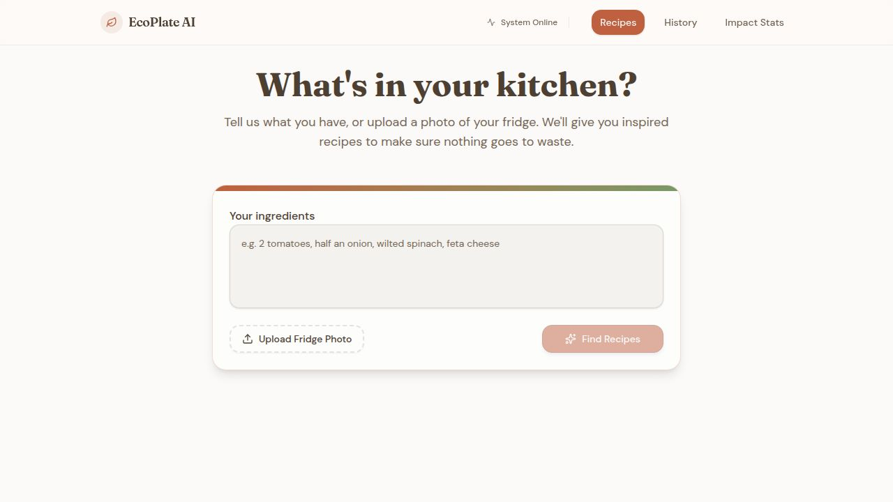
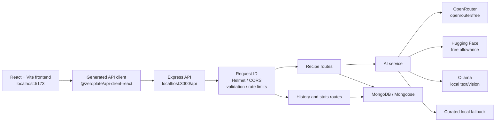

# sustainableAI


**sustainableAI** is a full-stack food-assistance application that helps people use ingredients they already have. Users can enter ingredients manually or upload a fridge or food image, choose a cuisine, and receive recipe suggestions designed to maximize ingredient usage and reduce avoidable food waste.

The repository is an active development project. It includes a React/Vite web application, an Express/TypeScript API, generated API types, optional MongoDB persistence, OpenRouter/Hugging Face/Ollama provider failover, and deterministic local fallback recipes.

> **Current integration status:** The backend uses OpenRouter's `openrouter/free` router first, skips Hugging Face and Ollama by default unless explicitly enabled, and returns deterministic local recipes when providers are unavailable.

## Contents

- [Overview](#overview)
- [Features](#features)
- [Screenshots and demo](#screenshots-and-demo)
- [How it works](#how-it-works)
- [Technology stack](#technology-stack)
- [Architecture](#architecture)
- [Repository structure](#repository-structure)
- [Prerequisites](#prerequisites)
- [Installation](#installation)
- [Environment configuration](#environment-configuration)
- [Provider diagnostics](#provider-diagnostics)
- [Database configuration](#database-configuration)
- [Running locally](#running-locally)
- [URLs and API endpoints](#urls-and-api-endpoints)
- [API reference](#api-reference)
- [AI workflows](#ai-workflows)
- [Build and test commands](#build-and-test-commands)
- [Troubleshooting](#troubleshooting)
- [Security practices](#security-practices)
- [Performance, limitations, and known issues](#performance-limitations-and-known-issues)
- [Contributing](#contributing)
- [License and acknowledgments](#license-and-acknowledgments)
- [Proposed future improvements](#proposed-future-improvements)
- [Contact and support](#contact-and-support)

## Overview

### Problem

Ingredients are often discarded because people do not know what to cook with them, how to combine leftovers, or which additional ingredients are actually necessary.

### Solution

sustainableAI provides:

1. A manual ingredient entry flow that accepts comma-separated text or ingredient arrays.
2. Optional image-based ingredient detection for JPEG, PNG, and WebP images.
3. Cuisine-specific recipe generation.
4. Recipe metadata showing used and missing ingredients, cooking time, difficulty, and sustainability context.
5. Recipe history and aggregate impact statistics when MongoDB is available.
6. A deterministic fallback path so the application can still return useful recipe suggestions when external AI services are unavailable.

### Intended users

- Home cooks working with available pantry or refrigerator ingredients.
- People trying to reduce food waste.
- Developers exploring a typed React/Express AI application with provider fallback behavior.

## Features

| Feature | Status | Implementation |
| --- | --- | --- |
| Manual ingredient entry | Implemented | Home page accepts free-form ingredient text and normalizes/deduplicates it before submission. |
| Cuisine selection | Implemented | Italian, Indian, Chinese, Mexican, Mediterranean, Japanese, Thai, and French options are exposed in the frontend. |
| Recipe generation | Implemented | `POST /api/recipes` validates input and tries configured AI providers before local fallback recipes. |
| Ingredient recognition from an image | Implemented | `POST /api/recipes/detect-ingredients` accepts one in-memory image upload, up to 5 MB. |
| Recipe history | Implemented | MongoDB-backed history is saved after successful generation when the database is connected. |
| Impact statistics | Implemented | `GET /api/recipes/stats` calculates search, ingredient, top-ingredient, and waste-reduction values. |
| Local fallback recipes | Implemented | Curated cuisine-aware recipes are returned when providers fail and `AI_STRICT_MODE=false`. |
| Request validation | Implemented | Zod schemas validate request and response envelopes. |
| Production API-key protection | Implemented | Mutating/AI routes require `X-API-Key` in production when `INTERNAL_API_KEY` is configured. |
| Ollama support | Implemented | Optional local text and vision fallback through the backend-only Ollama API. |
| Public deployment | Not verified | No deployment URL or hosting configuration is present in the repository. |

## Screenshots and demo

The repository contains an Open Graph image that can be used as a project preview:



No hosted demo URL or committed application screenshots were found. Run the application locally to try the interface.

## How it works

1. The user opens the React frontend and enters ingredients or selects **Upload Fridge Photo**.
2. The frontend uses the generated API client and `VITE_API_URL` to call the Express backend.
3. The backend assigns a request ID, applies security middleware, parses the request, and validates it with generated Zod schemas.
4. Recipe generation and image detection use OpenRouter Free Router, Hugging Face free inference, Ollama, then curated fallback.
5. If all providers fail, the backend returns curated internal recipes unless `AI_STRICT_MODE=true`.
6. Successful recipe searches are saved to MongoDB when a connection is available.
7. The History and Stats pages read the persisted data. When MongoDB is disconnected, history returns an empty list and stats return zero values.

## Technology stack

### Frontend

- React 18
- TypeScript
- Vite
- Wouter for client-side routing
- TanStack React Query for server state
- Tailwind CSS v4
- Radix UI components
- `lucide-react` icons
- `date-fns` for history date formatting

Frontend routes currently include `/`, `/history`, and `/stats`.

### Backend

- Node.js with native `fetch`
- Express 4
- TypeScript with ESM output
- Helmet security headers
- CORS
- `express-rate-limit`
- Multer memory storage for image uploads
- Pino and `pino-http` logging
- Zod validation through `@zeroplate/api-zod`

### AI/ML services

- OpenRouter Free Router (`openrouter/free`) as the primary hosted provider.
- Hugging Face Inference Providers as the secondary hosted provider, using only its available free allowance.
- Ollama as an optional local text/vision provider.
- Deterministic local recipe and ingredient lists as the final fallback.

### Database

- MongoDB through Mongoose.
- `recipe_history` collection for generated-search metadata.
- MongoDB is optional for development; the API continues in fallback/disconnected mode when it cannot connect.

### Development tools

- npm workspaces
- `tsx` watch mode
- Vitest
- Vite
- TypeScript compiler
- Concurrently

## Architecture



The provider sequence is implemented in the backend, not in the browser. API keys remain server-side.

## Repository structure

```text
.
├── artifacts/
│   ├── api-server/
│   │   ├── src/
│   │   │   ├── db/                 MongoDB connection and history model
│   │   │   ├── lib/                AI service, logging, response validation
│   │   │   ├── middlewares/        Auth, uploads, request IDs, errors, limits
│   │   │   ├── routes/             Health and recipe endpoints
│   │   │   ├── app.ts              Express middleware and route assembly
│   │   │   ├── config.ts            Environment loading and configuration
│   │   │   └── index.ts             Server startup and shutdown
│   │   ├── test/app.test.ts         API route tests
│   │   └── package.json
│   └── eco-plate-ai/
│       ├── src/
│       │   ├── components/          Layout and UI components
│       │   ├── hooks/               Recipe-generation client workflow
│       │   ├── pages/               Home, history, stats, not-found
│       │   ├── utils/               Ingredient and sustainability helpers
│       │   ├── App.tsx              Frontend routes and API base URL
│       │   └── main.tsx             React entry point
│       ├── public/                  Favicon and Open Graph image
│       ├── vite.config.ts
│       └── package.json
├── lib/
│   ├── api-client-react/            Generated React API hooks/client
│   ├── api-spec/openapi.yaml        OpenAPI 3.1 source specification
│   ├── api-zod/                     Generated request/response schemas
│   └── db/                          Shared database schema/configuration
├── .env.example                     Environment variable template
├── package.json                     Root workspace scripts
├── package-lock.json                npm lockfile
├── run-project.bat                  Windows development launcher
└── README.md
```

## Prerequisites

The package manifests do not declare an `engines` field, so the repository does not formally pin a supported Node.js version. Use a current Node.js release that supports native `fetch`, ESM, and the installed TypeScript/Vite toolchain. npm is required because the repository uses npm workspaces and includes `package-lock.json`.

You may also need:

- An OpenRouter key for the primary hosted provider, with optional Hugging Face or Ollama failover.
- A Hugging Face API key if the Hugging Face fallback is desired.
- A MongoDB deployment and connection string for persistent history and statistics.
- PowerShell on Windows if using `run-project.bat` (the batch file invokes PowerShell to manage port 3000).

External services are optional in development because the API has a local fallback path. They are not optional if you require live AI generation or persistent history.

## Installation

### Windows PowerShell

From the repository root:

```powershell
npm install
Copy-Item .env.example .env
```

Edit `.env` with valid credentials and connection settings. Then start both workspaces:

```powershell
npm run dev
```

Alternatively, use the repository launcher from Command Prompt or PowerShell:

```powershell
.\run-project.bat
```

The launcher checks dependencies, checks for `.env` and `OPENROUTER_API_KEY`, attempts to free a stale Node process on port 3000, and starts `npm run dev`.

### macOS/Linux

The npm scripts are portable:

```bash
npm install
cp .env.example .env
npm run dev
```

`run-project.bat` is Windows-specific. Use the npm commands directly on macOS/Linux.

## Environment configuration

Create `.env` from `.env.example`. Never commit `.env`; it is excluded by `.gitignore`.

| Variable | Required | Description |
| --- | --- | --- |
| `PORT` | No | Backend port. Defaults to `3000`. |
| `NODE_ENV` | No | `development`, `production`, or `test`; unrecognized values fall back to development. |
| `LOG_LEVEL` | No | Pino log level. Defaults to `info`. |
| `CORS_ORIGINS` | Production | Comma-separated allowed origins appended to the built-in localhost origins. |
| `MONGODB_URI` | No | MongoDB connection string. Without it, persistence is skipped. |
| `INTERNAL_API_KEY` | Production | Expected `X-API-Key` for protected AI/write routes. |
| `OPENROUTER_API_KEY` | No | Server-side OpenRouter credential. Only the `openrouter/free` router is selected. |
| `HUGGINGFACE_API_KEY` | No | Server-side Hugging Face credential. Used only with the free inference allowance. |
| `HF_FREE_ONLY_ENABLED` | No | Must be explicitly set to `true` after manually confirming free-allowance eligibility; defaults to `false`. |
| `OLLAMA_BASE_URL` | No | Private/local Ollama URL. Defaults to `http://127.0.0.1:11434`; never accepted from browser requests. |
| `OLLAMA_ENABLED` | No | Enables local Ollama only when explicitly set to `true`; defaults to `false`. |
| `OLLAMA_TIMEOUT_MS` | No | Finite local inference timeout in milliseconds. Defaults to `120000` and is capped at 120000. |
| `OLLAMA_TEXT_MODEL` | No | Installed local text model. Defaults to `qwen2.5vl:3b`. `OLLAMA_MODEL` remains accepted as a legacy alias. |
| `OLLAMA_VISION_MODEL` | No | Installed local vision model. Defaults to `qwen2.5vl:3b`. |
| `GEMINI_API_KEY` | Diagnostics | Retained for Gemini compatibility helpers and health diagnostics; it is not in the main failover order. |
| `VITE_PORT` | Frontend | Vite dev/preview port. Defaults to `5173`. |
| `VITE_BASE_PATH` | Frontend | Frontend base path. Defaults to `/`. |
| `VITE_API_URL` | Frontend | Backend base URL. Defaults to `http://localhost:3000`. |

The backend also reads optional operational variables from `process.env` in the AI service, including `AI_STRICT_MODE`, provider timeout/model variables, `CACHE_AI_RESPONSES`, and Hugging Face endpoint/model variables. The checked-in `.env.example` is the primary documented template; inspect `aiService.ts` before adding provider-specific overrides.

Safe local template:

```dotenv
PORT=3000
NODE_ENV=development
LOG_LEVEL=info
MONGODB_URI=mongodb://127.0.0.1:27017/sustainableai
INTERNAL_API_KEY=replace-with-a-long-random-secret
OPENROUTER_API_KEY=replace-with-your-openrouter-key
HUGGINGFACE_API_KEY=replace-with-your-huggingface-token
HF_FREE_ONLY_ENABLED=false
OLLAMA_BASE_URL=http://127.0.0.1:11434
OLLAMA_ENABLED=false
OLLAMA_TIMEOUT_MS=120000
OLLAMA_TEXT_MODEL=qwen2.5vl:3b
OLLAMA_VISION_MODEL=qwen2.5vl:3b
VITE_PORT=5173
VITE_BASE_PATH=/
VITE_API_URL=http://localhost:3000
```

## Provider architecture

Recipe generation and image analysis use this bounded order:

1. OpenRouter `openrouter/free` (primary hosted provider).
2. Hugging Face Inference Providers only when `HF_FREE_ONLY_ENABLED=true` and the account has been manually confirmed eligible for included free allowance.
3. Local Ollama only when `OLLAMA_ENABLED=true` and the configured text or vision model is installed.
4. Deterministic local fallback.

Alternate providers are reported with their actual provider name and `isFallback: true`; only successful OpenRouter output is primary output. Provider errors are classified as authentication, permission/quota, rate limit, timeout, model-not-found, or service-unavailable. Hosted requests use bounded retries only for transient statuses. No provider is treated as unlimited or guaranteed.

With the default settings, the effective zero-cost chain is OpenRouter `openrouter/free` -> Hugging Face skipped -> Ollama skipped -> deterministic fallback. Ollama enters failover only after `qwen2.5vl:3b` (or another configured model) is installed and `OLLAMA_ENABLED=true` is explicitly set.

OpenRouter is deliberately restricted to `openrouter/free`; the application never selects `openrouter/auto` or a paid model. Hugging Face does not enable billing or paid inference. Keep all provider credentials server-side in `.env`.

### Ollama setup

Install Ollama from [ollama.com](https://ollama.com), then install compatible models:

```powershell
ollama pull qwen2.5vl:3b
ollama list
```

The default `qwen2.5vl:3b` model supports both text and image inputs, is approximately 3.2 GB, and requires Ollama 0.7.0 or newer. Ollama is available only when the backend runs on the same machine or can reach an explicitly secured private network. Do not expose port `11434` publicly. Local inference can be slow or unavailable on CPU-only hardware and model downloads require substantial disk space and RAM/VRAM.

## Provider diagnostics and compatibility helpers

The backend retains isolated compatibility helpers for historical diagnostics and tests. They are not part of the active provider chain:

- Reads `GEMINI_API_KEY` in `src/config.ts`.
- Calls `https://generativelanguage.googleapis.com/v1beta/openai/chat/completions`.
- Uses the configured model constant `gemini-3.8-flash`.
- Sends chat-completion requests with a sustainability-focused recipe prompt.
- Retries failed or empty responses up to two times after the initial attempt.
- Uses a request timeout of 20 seconds by default.

Validate configuration without exposing the key:

```powershell
Invoke-WebRequest -UseBasicParsing http://localhost:3000/api/healthz
Invoke-WebRequest -UseBasicParsing http://localhost:3000/api/ai/health
```

The health endpoints report the active OpenRouter-first configuration and whether optional providers are enabled. A configured provider can still fail at request time, so response metadata remains authoritative.

Do not put Gemini credentials in frontend code or `VITE_*` variables. Vite variables are exposed to the browser.

## Database configuration

MongoDB is used for the `recipe_history` collection. Each saved entry contains:

- normalized ingredients
- selected cuisine
- generated recipe count
- missing ingredient count
- creation timestamp

The connection uses Mongoose with a 5-second server-selection timeout and a 45-second socket timeout. If `MONGODB_URI` is missing or the connection fails, the server logs the problem and continues without persistence:

- `GET /api/recipes/history` returns `{ "history": [] }`.
- `GET /api/recipes/stats` returns zero-valued statistics.
- Recipe generation still returns recipes, but a successful search is not saved.
- Deleting history returns `503` while the database is unavailable.

## Running locally

Development mode starts the API and frontend concurrently:

```powershell
npm run dev
```

Individual workspace commands:

```powershell
npm run dev --workspace=artifacts/api-server
npm run dev --workspace=artifacts/eco-plate-ai
```

For a Windows launch with dependency and port checks:

```powershell
.\run-project.bat
```

The frontend may move to the next available Vite port if its configured port is already occupied. The backend does not automatically select another API port; set `PORT` in `.env` and update `VITE_API_URL` to match.

## URLs and API endpoints

Default local URLs:

- Frontend: <http://localhost:5173/>
- API base: <http://localhost:3000/api>
- Health: <http://localhost:3000/api/healthz>
- AI provider health: <http://localhost:3000/api/ai/health>

If Vite reports that port 5173 is occupied, use the port printed in its startup output.

## API reference

All API responses use an envelope shaped like:

```json
{
  "success": true,
  "data": {},
  "error": null
}
```

Errors use:

```json
{
  "success": false,
  "data": null,
  "error": {
    "message": "Description of the error",
    "details": "Optional development detail"
  }
}
```

### `GET /api/healthz`

Returns service configuration and connectivity state. It does not require an API key.

```bash
curl http://localhost:3000/api/healthz
```

Example shape:

```json
{
  "success": true,
  "data": {
    "status": "ok",
    "timestamp": "2026-01-01T00:00:00.000Z",
    "environment": "development",
    "port": 3000,
    "database": "connected",
    "ai": {
      "openrouter": "missing",
      "huggingface": "skipped",
      "ollama": "skipped"
    }
  },
  "error": null
}
```

### `GET /api/ai/health`

Reports the active provider configuration without making inference requests. The response is not wrapped in the standard envelope. Hugging Face is skipped unless `HF_FREE_ONLY_ENABLED=true`, and Ollama is skipped unless it is enabled with a valid local model:

```bash
curl http://localhost:3000/api/ai/health
```

```json
{
  "openrouter": "configured",
  "huggingface": "skipped",
  "ollama": "skipped",
  "fallback": "available",
  "lastChecked": "2026-01-01T00:00:00.000Z"
}
```

The values can be `working` or `failed`; a configured provider may still fail its live check.

### `POST /api/recipes`

Generates exactly up to two normalized recipe suggestions from an ingredient string or array. In production, send `X-API-Key` with the value configured in `INTERNAL_API_KEY`.

```bash
curl -X POST http://localhost:3000/api/recipes \
  -H "Content-Type: application/json" \
  -d "{\"ingredients\":[\"tomato\",\"onion\",\"garlic\"],\"cuisine\":\"Italian\"}"
```

Request:

```json
{
  "ingredients": ["tomato", "onion", "garlic"],
  "cuisine": "Italian"
}
```

`ingredients` may also be a comma-separated string. `cuisine` is optional and may be `null`.

Successful response data includes:

```json
{
  "recipes": [
    {
      "name": "Example recipe",
      "description": "Recipe description",
      "instructions": "Preparation steps",
      "cookTime": "25 minutes",
      "difficulty": "easy",
      "used": ["tomato", "onion"],
      "missing": ["pasta"]
    }
  ],
  "sustainabilityMessage": "You reduced food waste by using available ingredients.",
  "ingredientsUsed": ["tomato", "onion", "garlic"],
  "cuisine": "Italian",
  "isFallback": false,
  "provider": "openrouter",
  "confidence": 0.9,
  "cacheHit": false
}
```

Common errors:

- `400` when ingredients/cuisine has the wrong format or ingredients are empty.
- `401` in production when `X-API-Key` is missing or incorrect.
- `429` in production after the AI route limit is exceeded.
- `503` when `AI_STRICT_MODE=true` and all configured AI providers fail.

### `POST /api/recipes/detect-ingredients`

Accepts one multipart file named `image`. The accepted MIME types are JPEG, PNG, and WebP. The maximum size is 5 MB, and the server also checks the image signature in the uploaded bytes.

```bash
curl -X POST http://localhost:3000/api/recipes/detect-ingredients \
  -F "image=@./path/to/fridge.jpg"
```

Successful response data has this shape:

```json
{
  "ingredients": ["tomato", "onion"],
  "confidence": 0.9,
  "isApproximate": false,
  "provider": "openrouter",
  "low_confidence": false
}
```

Common errors:

- `400` when no file is sent, the MIME type is unsupported, or the file signature is invalid.
- `401` in production when the internal API key is missing or incorrect.
- `429` in production after the AI route limit is exceeded.
- `503` when strict AI mode is enabled and all providers fail.

When strict mode is disabled, a failed detection returns the approximate starter list `tomato, onion, garlic, olive oil, salt, pepper` with fallback metadata rather than failing the request.

### `GET /api/recipes/history`

Returns the 20 most recent history entries, newest first. It does not require the production API key.

```bash
curl http://localhost:3000/api/recipes/history
```

When MongoDB is unavailable, the successful response contains an empty `history` array.

### `DELETE /api/recipes/history/:id`

Deletes one MongoDB history document. In production it requires `X-API-Key`.

```bash
curl -X DELETE http://localhost:3000/api/recipes/history/665000000000000000000000 \
  -H "X-API-Key: replace-with-your-internal-key"
```

Returns `{ "deleted": true }` on success, `404` when the item does not exist, and `503` when MongoDB is unavailable.

### `GET /api/recipes/stats`

Returns:

- `totalSearches`
- `totalIngredientsUsed`
- up to five `mostUsedIngredients`
- a calculated `wasteReductionScore` capped at 100

```bash
curl http://localhost:3000/api/recipes/stats
```

The OpenAPI source for these contracts is [`lib/api-spec/openapi.yaml`](./lib/api-spec/openapi.yaml).

## AI workflows

### Recipe generation

The backend normalizes ingredients by trimming, lowercasing, and deduplicating them. It then:

1. Checks the in-memory recipe cache.
2. Uses the circuit breaker if repeated provider failures have exceeded the threshold.
3. Attempts OpenRouter using only `openrouter/free`.
4. Attempts Hugging Face using only its configured free allowance.
5. Attempts local Ollama when configured and reachable.
6. Parses and validates provider output, keeping at most two recipes.
7. Returns the curated internal fallback when providers fail and strict mode is disabled.

The recipe cache has a five-minute TTL. Non-fallback AI responses are only reused when `CACHE_AI_RESPONSES=true`; fallback responses can be cached. The circuit breaker is in-memory and resets when the process restarts.

### Image ingredient detection

Uploaded images are kept in memory and converted to a base64 data URL for the AI service. The order is:

1. OpenRouter `openrouter/free` multimodal request.
2. Hugging Face free inference multimodal request.
3. Ollama native `images` request using `OLLAMA_VISION_MODEL`.
4. Approximate starter ingredients when strict mode is disabled.

The frontend marks fallback detection as approximate and lets the user edit the resulting ingredient list before recipe generation.

### Ollama status

If Ollama is disabled, unavailable, stopped, or missing `OLLAMA_TEXT_MODEL`/`OLLAMA_VISION_MODEL`, the backend records a sanitized provider failure and continues to deterministic fallback. Check `ollama list`, verify the model names in `.env`, set `OLLAMA_ENABLED=true`, and confirm the backend can reach the private `OLLAMA_BASE_URL`.

### Standalone Python vision pipeline

The root-level Python modules (`pipeline.py`, `providers/`, and `image_utils.py`) are a separate, optional vision fallback subsystem. They are not used by the React/Express application and do not change its hosted-provider configuration. The Python subsystem supports local image paths and in-memory image bytes; remote HTTP(S) image URLs are intentionally rejected because no safe, validated IP-pinning transport is bundled with the project. This avoids DNS-rebinding and proxy-based SSRF risks. Callers that need remote images must fetch them through a separately controlled service and pass validated bytes to the pipeline.

## Build and test commands

These are the scripts declared in the repository manifests:

| Command | Purpose |
| --- | --- |
| `npm run dev` | Start API and frontend concurrently. |
| `npm start` | Start the built API entry point at `artifacts/api-server/dist/index.js`. |
| `npm run build` | Build shared API schemas, shared DB package, frontend, and API server. |
| `npm run build:backend` | Build `lib/api-zod`, `lib/db`, and the API server. |
| `npm run build:frontend` | Build the Vite frontend. |
| `npm run clean` | Remove `node_modules` and `package-lock.json` using Unix-style `rm -rf`. |
| `npm run dev --workspace=artifacts/api-server` | Run the API in `tsx` watch mode. |
| `npm run build --workspace=artifacts/api-server` | Compile the API with TypeScript. |
| `npm run start --workspace=artifacts/api-server` | Start the compiled API. |
| `npm run test --workspace=artifacts/api-server` | Run the API Vitest suite. |
| `npm run dev --workspace=artifacts/eco-plate-ai` | Run the frontend with Vite. |
| `npm run build --workspace=artifacts/eco-plate-ai` | Build the frontend. |
| `npm run preview --workspace=artifacts/eco-plate-ai` | Preview the frontend build. |

There is no lint script declared in the root or workspace `package.json` files. The repository does not declare a root-level test script; run the API test command above.

## Troubleshooting

### Port 3000 is already in use

The API requires `PORT` (3000 by default). On Windows, `run-project.bat` attempts to stop an existing Node process on port 3000 and verifies that the port is free. If another application owns it, stop that application or choose another port:

```dotenv
PORT=3001
VITE_API_URL=http://localhost:3001
```

Restart both services after changing the values.

### Port 5173 is already in use

Vite may select the next available port and print it in the terminal. Open the printed frontend URL. To choose a fixed port, set `VITE_PORT`; ensure that port is free.

### Missing hosted credentials or Ollama models

Set `OPENROUTER_API_KEY` and/or `HUGGINGFACE_API_KEY`, or install the configured Ollama models with `ollama pull`. Credentials and model settings are read at process startup, so changing `.env` does not update an already-running server.

### AI responses become fallback recipes

Fallback output is expected when OpenRouter, Hugging Face, and Ollama are missing, reject requests, time out, lack quota, or produce output that cannot be parsed. Check the response fields `provider`, `isFallback`, `confidence`, and `low_confidence`. Set `AI_STRICT_MODE=true` if unavailable AI should produce a `503` instead of a local fallback.

### MongoDB DNS or connection failure

Verify `MONGODB_URI`, DNS resolution, network access, Atlas IP allowlisting, credentials, and the selected database name. The application intentionally continues without persistence after a connection failure, so a successful health response can still report `"database": "disconnected"`.

### Dependencies or workspace packages cannot be resolved

Run installation from the repository root:

```powershell
npm install
```

The project uses npm workspaces for `artifacts/*` and `lib/*`; do not install only inside one workspace unless you understand the resulting workspace links.

### API returns `401`

In production, send `X-API-Key` with the exact value of `INTERNAL_API_KEY` for protected AI and delete routes. Development mode bypasses this middleware by design.

## Security practices

- Keep `.env` local. It is ignored by `.gitignore`; commit only safe placeholders in `.env.example`.
- Never place OpenRouter, Hugging Face, MongoDB, or internal API keys in frontend source or `VITE_*` variables.
- Use a long, random `INTERNAL_API_KEY` in production.
- Keep `NODE_ENV=production` for deployed environments so API-key protection and AI rate limiting are enabled.
- Use HTTPS and restrict `CORS_ORIGINS` in production.
- The API uses Helmet, request IDs, centralized errors, CORS checks, and response validation.
- Uploaded images are held in memory, limited to 5 MB, restricted to JPEG/PNG/WebP MIME types, and checked for file signatures.
- Provider response bodies and authorization headers are not logged; only safe classifications and response-presence metadata are recorded.
- Revoke and replace any credential that has been pasted into source control, chat, issue comments, or logs.

## Performance, limitations, and known issues

- AI requests have provider-specific timeouts and retries, so a failed request can take several seconds before fallback output is returned.
- The AI circuit breaker and recipe cache are process-local; they are not shared across instances and are lost on restart.
- MongoDB is required for durable history and statistics. Disconnected mode returns safe empty/zero values rather than persisted data.
- The frontend can call the API in development without an internal API key, while production protection depends on environment configuration.
- OpenRouter is restricted to the free router and may be rate-limited or unavailable.
- Hosted free allowances are finite and are not guaranteed to provide unlimited requests or uptime.
- Hugging Face fallback models and providers can reject unsupported model/provider combinations.
- The image detector is approximate when fallback data is returned; users should review and edit detected ingredients.
- No deployment configuration, migration framework, or license file is present.
- There is no repository-declared Node.js version or lint script.

## Contributing

1. Create a focused branch from the current development branch.
2. Run `npm install` from the repository root.
3. Copy `.env.example` to `.env` and use test or local credentials only.
4. Make the smallest change that addresses the issue.
5. Update generated API contracts and consumers together when changing the API specification.
6. Run the narrowest relevant build and test commands:

   ```powershell
   npm run build:backend
   npm run build:frontend
   npm run test --workspace=artifacts/api-server
   ```

7. Do not commit `.env`, credentials, generated build output, logs, or local database data.
8. Describe provider behavior, fallback behavior, and configuration changes in the pull request.

## License and acknowledgments

No `LICENSE` file or license declaration was found in the repository. The project license has **not yet been specified**. Add an explicit license before distributing the project or accepting contributions under defined reuse terms.

The project uses open-source packages listed in the root and workspace `package.json` files, including React, Vite, Express, Mongoose, Zod, TanStack Query, Radix UI, Tailwind CSS, Pino, and Vitest.

## Proposed future improvements

These are proposals, not implemented functionality:

- Replace the fixed Gemini model constant with a validated environment setting or provider capability check.
- Add an explicit Ollama adapter and document a configurable provider order if local inference is desired.
- Add a formal Node.js version policy and CI matrix.
- Add a lint script and repository-wide formatting policy.
- Add integration tests for successful and failed provider calls, image uploads, MongoDB disconnected mode, and production API-key enforcement.
- Add a formal migration/versioning strategy for persisted history data.
- Add deployment documentation and a monitored hosted demo.
- Add a repository license and contribution/security policy files.

## Contact and support

No maintainer email, support portal, issue template, or public demo URL is declared in the repository. For project-specific support, open an issue in the repository where this code is hosted and include:

- the command used
- the relevant endpoint and HTTP status
- sanitized logs
- the Node.js/npm versions
- whether MongoDB and external AI providers were available

Never include API keys, tokens, passwords, MongoDB connection strings, or unredacted provider responses in an issue.
